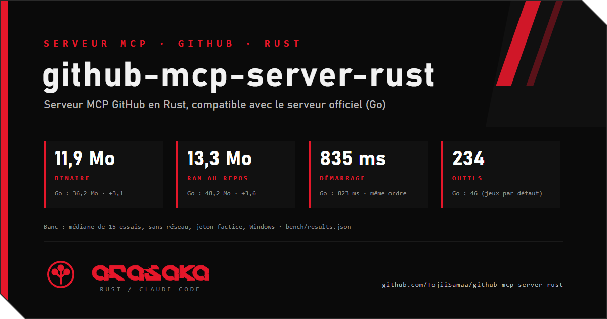

<p align="center"></p>

<!-- stats:debut -->
| | Official server (Go): default toolsets / `--toolsets all` | `ghmcp` (Rust) |
|---|---|---|
| Startup time (median, to first `tools/list`) | 313.0 ms / 346.2 ms | 274.0 ms |
| Startup range (min-max, 21 trials) | 288-539 ms / 327-562 ms | 247-362 ms |
| Memory at idle (RSS) | 43.4 MB / 46.0 MB | 12.6 MB |
| Binary size | 35.7 MB | 10.5 MB |
| Tools in `tools/list` | 46 / 91 | 234 |
| Report (21 trials, Linux x64 (noyau WSL2), conteneur Docker limité à 2 coeurs; Go commit `6fbcd00`, ghmcp commit `5ff8bee`) | [bench/results.json](bench/results.json) | [bench/chart.svg](bench/chart.svg) |
| Several accounts at once (`account` on every call) | not documented | yes |
| Auth: classic token, fine-grained token, GitHub App | token or OAuth; [GitHub App documented](https://github.com/github/github-mcp-server/blob/main/docs/github-app-auth.md) | yes, all three, per account |
| Webhooks (receive, verify, manage) | not documented | yes (`serve`, HMAC SHA-256; `gh_repo_hook*`, `gh_org_hook*`) |
| Activity journal (PR, CI, invitations, alerts) | not documented | yes (SQLite, JSON API, SSE) |
| Rules to webhook / Discord / command | not documented | yes (`[[rules]]`) |
| Test mode (no network) | not documented | yes (`--test`) |
| Statistics | not documented | yes (`gh_stats`) |
<!-- stats:fin -->

<p align="center"></p>

# ghmcp: GitHub MCP server in Rust

**Français, en bref.** Serveur MCP GitHub en Rust, binaire unique. Il reprend les 133 outils du serveur officiel (mêmes schémas), y ajoute 101 outils `gh_*` de gestion (dépôts, organisations, webhooks, Actions, paquets, Pages, environnements, sécurité, activité, statistiques), gère plusieurs comptes (jeton classique, jeton fin, GitHub App), suit toute l'activité dans un journal (PR, CI, invitations, alertes) et déclenche des règles vers un webhook, Discord ou une commande. Le mode test (`--test`) simule tout sans toucher au réseau. Les écritures sensibles demandent une validation humaine. Le skill pour les agents est dans [`rust/skill/github-mcp-rust/SKILL.md`](rust/skill/github-mcp-rust/SKILL.md). Le serveur Go d'origine reste intact dans ce fork : voir [`README-go.md`](README-go.md).

---

A GitHub MCP server written in Rust. It keeps every tool of the official [github/github-mcp-server](https://github.com/github/github-mcp-server) (same names, same input schemas, checked against the official snapshots), adds an administration layer, handles several accounts, records everything that happens on GitHub in a journal, and runs rules on it. One binary, no runtime.

> **Layout.** This repository is a fork of the official Go server. The Go code stays untouched at the root (its original README is [`README-go.md`](README-go.md)). The Rust workspace lives in [`rust/`](rust/); the commands below are run from there.

Agents: read [`rust/skill/github-mcp-rust/SKILL.md`](rust/skill/github-mcp-rust/SKILL.md) (every tool with its parameters, required scope and fine-grained permission, recipes, test mode) and [`rust/AGENTS.md`](rust/AGENTS.md).

## Contents

[Installation](#installation) · [Configuration](#configuration) · [Use with a client](#use-with-a-client) · [Tools](#tools-234) · [Permissions](#permissions-and-token-setup) · [Webhooks and `serve`](#webhooks-and-serve) · [Rules](#rules-and-destinations) · [Test mode](#test-mode) · [Statistics](#statistics) · [Security](#security) · [Limits](#limits-what-it-cannot-do) · [FAQ](#faq) · [Development](#development) · [Licenses](#licenses)

## Installation

Requires Rust 1.80 or newer to build. Pick one.

**Release binary.** When a release is published, download the archive for your platform from the Releases page of this repository, unpack it and put `ghmcp` on your `PATH`. No release is guaranteed for every platform; building from source always works.

**Build from source** (from the repository root):

```bash
cd rust
cargo build --release -p ghmcp        # target/release/ghmcp (ghmcp.exe on Windows)
```

**`cargo install`** (from a checkout, installs into `~/.cargo/bin`):

```bash
cd rust
cargo install --path crates/server --locked
```

There is no Docker image for the Rust server. The `Dockerfile` at the repository root belongs to the Go server.

Check the build with no account and no network:

```bash
ghmcp --test        # then send initialize / tools/list on stdin
```

## Configuration

### Without a config file

With no config file, a single account is read from `GITHUB_PERSONAL_ACCESS_TOKEN`, exactly like the official server. `GITHUB_API_URL` sets the API base (GitHub Enterprise Server); the default is `https://api.github.com`.

### Config file

The file is searched in this order: `--config FILE`, the `GHMCP_CONFIG` variable, then `~/.config/ghmcp/config.toml` (`$XDG_CONFIG_HOME/ghmcp/config.toml` if set; on Windows `%APPDATA%\ghmcp\config.toml`). The secrets are never in the file, only the name of the variable or file that holds them. A fictitious full example is in [`rust/config.example.toml`](rust/config.example.toml).

```toml
default_account = "alice-test"

[[accounts]]
name = "alice-test"
kind = "classic"                 # classic | fine | app
token_env = "GHMCP_ALICE_TOKEN"  # variable holding the token

[[accounts]]
name = "bob-ci"
kind = "fine"
token_file = "/path/to/bob-ci.token"

[[accounts]]
name = "carol-cmd"
kind = "fine"
token_cmd = ["manager", "read", "fictitious-token"]   # program + arguments, no shell

[[accounts]]
name = "robot-app"
kind = "app"
app_id = 123456
installation_id = 7654321
private_key_file = "/path/to/robot-app.private-key.pem"
# private_key_env = "GHMCP_ROBOT_KEY"                  # or the PEM in a variable
# api_url = "https://ghe.example.invalid/api/v3"       # GitHub Enterprise Server
```

Every tool accepts an optional `account`; absent means `default_account`. An unknown name returns the list of known accounts.

| Key | Where | Meaning |
|---|---|---|
| `default_account` | top level | account used when a call has no `account` |
| `name` | `[[accounts]]` | account name, passed as `account` |
| `kind` | `[[accounts]]` | `classic`, `fine` or `app` |
| `token_env` | `[[accounts]]` | name of the environment variable that holds the token |
| `token_file` | `[[accounts]]` | path of a file that holds the token |
| `token_cmd` | `[[accounts]]` | array: program and arguments (no shell) whose standard output is the token |
| `app_id`, `installation_id` | `[[accounts]]` | both required when `kind = "app"` |
| `private_key_env`, `private_key_file` | `[[accounts]]` | PEM private key of the GitHub App |
| `api_url` | `[[accounts]]` | API base URL (default `https://api.github.com`) |
| `rules_file` | top level | separate TOML file for rules, relative to the config folder |
| `[webhook]` `secret_env` | section | variable holding the webhook secret |
| `[webhook]` `api_token_env` | section | variable holding a Bearer token required on `/api/*` and `/mcp` (optional on loopback, **mandatory** to listen on any other address) |
| `[poller]` `interval_secs`, `enabled` | section | periodic poll (default 300 s, minimum 30 s); `enabled = false` turns it off |
| `[destinations.<name>]` | section | `type` (`webhook`, `discord`, `command`), `url` or `url_env`, `program` and `args` |
| `[[rules]]` | section | `name`, `on`, `filters`, `to`, `actions` (see [Rules](#rules-and-destinations)) |
| `[actions]` | section | `enabled` (default `false`), `merge_method` (default `squash`), `invitation_allow` |

### Environment variables

| Variable | Effect |
|---|---|
| `GITHUB_PERSONAL_ACCESS_TOKEN` | token of the single account used when there is no config file |
| `GITHUB_API_URL` | API base for that single account (default `https://api.github.com`) |
| `GHMCP_CONFIG` | path of the config file (after `--config`) |
| `GHMCP_RULES` | path of a rules file; wins over `rules_file`; empty is ignored |
| `MCP_TEST_MODE` | `1` or `true`: [test mode](#test-mode), read at startup only |
| `MCP_TEST_APPROVER` | `approve`, `deny` (default), `timeout`, `absent`: simulated human validation in test mode |
| `GHMCP_FIXTURES` | folder of response fixtures used in test mode (default: the ones shipped in `crates/core/fixtures`) |
| `XDG_CONFIG_HOME`, `HOME`, `APPDATA` | where the default config path is looked up |
| the variables you name | `token_env`, `private_key_env`, `[webhook] secret_env` and `api_token_env`, and `url_env` of a destination are names of variables you choose |

### Tokens

Three kinds of credential, one per account:

- **Classic token** (`kind = "classic"`): scopes listed per tool in the skill (`repo`, `read:org`, `notifications`, ...).
- **Fine-grained token** (`kind = "fine"`): permissions listed per tool (`contents:write`, `administration:write`, ...).
- **GitHub App** (`kind = "app"`): `app_id`, `installation_id` and the private key; `ghmcp` exchanges them for an installation token.

For `classic` and `fine`, the token comes from `token_env`, then `token_file`, then `token_cmd` (the first one that gives something). `token_cmd` runs a password manager without a shell (Bitwarden, 1Password, KeePassXC, pass, Windows Credential Manager); its output is never logged and is not read in test mode. Order, recipes and errors: [`rust/docs/secrets.md`](rust/docs/secrets.md).

## Use with a client

The server speaks MCP over stdio by default. Replace the paths with yours.

**Claude Code**

```bash
claude mcp add github -- /path/to/ghmcp --config /path/to/config.toml
```

**Claude Desktop** (`claude_desktop_config.json`), **Cursor** (`.cursor/mcp.json`) and **VS Code** (`.vscode/mcp.json`, key `servers` instead of `mcpServers`):

```json
{
  "mcpServers": {
    "github": {
      "command": "/path/to/ghmcp",
      "args": ["--config", "/path/to/config.toml"]
    }
  }
}
```

With only one account and no file: `"env": { "GITHUB_PERSONAL_ACCESS_TOKEN": "..." }` instead of `args`.

**OpenCode** (`opencode.json`):

```json
{
  "mcp": {
    "github": {
      "type": "local",
      "command": ["/path/to/ghmcp", "--config", "/path/to/config.toml"]
    }
  }
}
```

**HTTP** for a client that talks to a URL: `ghmcp --http 127.0.0.1:8787` serves MCP on `POST /mcp`.

| Command | Effect |
|---|---|
| `ghmcp` | MCP on stdio |
| `ghmcp --http 127.0.0.1:8787` | MCP on HTTP (`POST /mcp`) |
| `ghmcp serve [--http ADDR] [--db FILE]` | MCP over HTTP + webhooks + activity API + rules and periodic poll (default `127.0.0.1:8787`, database `activity.db` next to the config) |
| `ghmcp gen-skill [FILE]` | rewrites the tool block of the skill from the real registry |
| `--config FILE`, `--test` | config file, test mode (also `GHMCP_CONFIG`, `MCP_TEST_MODE=1`) |

## Tools (234)

Exact content of `tools/list` (checked against the binary in test mode). The 133 tools without the `gh_` prefix are the official ones, same schema; the 101 `gh_*` tools are the extensions. For every tool the parameters, the scope or permission it needs and whether it asks a human first are in [`rust/skill/github-mcp-rust/SKILL.md`](rust/skill/github-mcp-rust/SKILL.md), with a call example each.

**Repositories and files**
`create_branch`, `create_or_update_file`, `create_repository`, `delete_file`, `delete_repository`, `fork_repository`, `get_commit`, `get_file_blame`, `get_file_contents`, `get_latest_release`, `get_release_by_tag`, `get_tag`, `get_repository_tree`, `list_branches`, `list_commits`, `list_releases`, `list_tags`, `list_repository_collaborators`, `list_starred_repositories`, `push_files`, `star_repository`, `unstar_repository`

**Search**
`search_repositories`, `search_code`, `search_commits`, `search_users`, `search_orgs`

**Gists**
`list_gists`, `get_gist`, `create_gist`, `update_gist`

**User, teams, notifications**
`get_me`, `get_teams`, `get_team_members`, `list_notifications`, `get_notification_details`, `dismiss_notification`, `mark_all_notifications_read`, `manage_notification_subscription`, `manage_repository_notification_subscription`

**Issues, labels, sub-issues**
`issue_read`, `issue_write`, `create_issue`, `list_issues`, `search_issues`, `list_issue_types`, `list_issue_fields`, `set_issue_fields`, `add_issue_comment`, `update_issue_comment`, `add_issue_comment_reaction`, `remove_issue_comment_reaction`, `add_issue_reaction`, `remove_issue_reaction`, `sub_issue_write`, `add_sub_issue`, `remove_sub_issue`, `reprioritize_sub_issue`, `update_issue_assignees`, `update_issue_body`, `update_issue_labels`, `update_issue_milestone`, `update_issue_state`, `update_issue_title`, `update_issue_type`, `get_label`, `list_label`, `label_write`, `issue_dependency_read`, `issue_dependency_write`, `issue_artifact_read`, `issue_artifact_write`, `find_duplicate`, `hide_issue_comment`, `unhide_issue_comment`

**Pull requests and reviews**
`pull_request_read`, `list_pull_requests`, `search_pull_requests`, `create_pull_request`, `update_pull_request`, `update_pull_request_title`, `update_pull_request_body`, `update_pull_request_state`, `update_pull_request_draft_state`, `update_pull_request_branch`, `merge_pull_request`, `request_pull_request_reviewers`, `create_pull_request_review`, `pull_request_review_write`, `add_comment_to_pending_review`, `add_pull_request_review_comment`, `add_reply_to_pull_request_comment`, `submit_pending_pull_request_review`, `delete_pending_pull_request_review`, `add_pull_request_review_comment_reaction`, `remove_pull_request_review_comment_reaction`, `resolve_review_thread`, `unresolve_review_thread`, `hide_pull_request_review`, `unhide_pull_request_review`, `hide_pull_request_review_comment`, `unhide_pull_request_review_comment`

**Actions (official)**
`actions_list`, `actions_get`, `actions_run_trigger`, `get_job_logs`

**Discussions**
`list_discussions`, `get_discussion`, `get_discussion_comments`, `list_discussion_categories`, `discussion_comment_write`

**Projects**
`projects_list`, `projects_get`, `projects_write`

**Security (official)**
`list_code_scanning_alerts`, `get_code_scanning_alert`, `list_secret_scanning_alerts`, `get_secret_scanning_alert`, `list_dependabot_alerts`, `get_dependabot_alert`, `list_global_security_advisories`, `get_global_security_advisory`, `list_repository_security_advisories`, `list_org_repository_security_advisories`, `get_code_quality_finding`

**Rulesets, custom properties, Copilot, UI**
`create_repository_ruleset`, `repository_ruleset_read`, `custom_properties_read`, `custom_properties_write`, `assign_copilot_to_issue`, `assign_copilot_to_issue_with_intent`, `request_copilot_review`, `ui_get`

**Administration (extension)**
`gh_repo_settings`, `gh_repo_topics`, `gh_repo_transfer`, `gh_branch_protection`, `gh_ruleset`, `gh_collaborator`, `gh_repo_invitation`, `gh_my_invitation`, `gh_org_invitation`, `gh_org`, `gh_org_member`, `gh_team`, `gh_team_member`, `gh_team_repo`

**Webhooks (extension)**
`gh_repo_hooks_list`, `gh_repo_hook_get`, `gh_repo_hook_create`, `gh_repo_hook_update`, `gh_repo_hook_delete`, `gh_repo_hook_deliveries`, `gh_repo_hook_delivery_get`, `gh_repo_hook_redeliver`, `gh_repo_hook_ping`, `gh_org_hooks_list`, `gh_org_hook_get`, `gh_org_hook_create`, `gh_org_hook_update`, `gh_org_hook_delete`, `gh_org_hook_deliveries`, `gh_org_hook_delivery_get`, `gh_org_hook_redeliver`, `gh_org_hook_ping`

**Actions administration (extension)**
`gh_actions_secrets_list`, `gh_actions_secret_set`, `gh_actions_secret_delete`, `gh_actions_variables_list`, `gh_actions_variable_get`, `gh_actions_variable_create`, `gh_actions_variable_update`, `gh_actions_variable_delete`, `gh_actions_runners_list`, `gh_actions_runner_token`, `gh_actions_runner_delete`, `gh_actions_run_rerun`, `gh_actions_run_rerun_failed`, `gh_actions_run_cancel`, `gh_actions_run_logs`, `gh_actions_permissions_get`, `gh_actions_permissions_set`

**Packages (extension)**
`gh_user_packages_list`, `gh_user_package_get`, `gh_user_package_versions_list`, `gh_user_package_version_get`, `gh_user_package_delete`, `gh_user_package_version_delete`, `gh_user_package_restore`, `gh_user_package_version_restore`, `gh_org_packages_list`, `gh_org_package_get`, `gh_org_package_versions_list`, `gh_org_package_version_get`, `gh_org_package_delete`, `gh_org_package_version_delete`, `gh_org_package_restore`, `gh_org_package_version_restore`

**Environments and deployments (extension)**
`gh_environments_list`, `gh_environment_get`, `gh_environment_set`, `gh_environment_delete`, `gh_environment_protection_rules_list`, `gh_environment_protection_rule_create`, `gh_environment_protection_rule_delete`, `gh_environment_branch_policies_list`, `gh_environment_branch_policy_create`, `gh_deployments_list`, `gh_deployment_create`, `gh_deployment_delete`, `gh_deployment_statuses_list`, `gh_deployment_status_create`

**Pages (extension)**
`gh_pages_get`, `gh_pages_create`, `gh_pages_update`, `gh_pages_build_request`, `gh_pages_build_latest`

**Security administration (extension)**
`gh_vulnerability_alerts_get`, `gh_vulnerability_alerts_set`, `gh_dependabot_security_updates_get`, `gh_dependabot_security_updates_set`, `gh_code_scanning_default_setup_get`, `gh_code_scanning_default_setup_set`, `gh_dependabot_alert_update`, `gh_secret_scanning_alert_update`, `gh_code_scanning_alert_update`, `gh_repo_security_analysis_set`

**Permissions, activity, statistics (extension)**
`gh_permissions_schema`, `gh_account_audit`, `gh_setup_urls`, `gh_activity_feed`, `gh_watch`, `gh_pr_dashboard`, `gh_stats`

Several official tools take a `method` that picks the operation (`actions_list`, `actions_get`, `actions_run_trigger`, `issue_read`, `issue_write`, `projects_list`, `projects_get`, `projects_write`); the exact values are in the skill. An unknown `method` answers `unknown method: <value>`.

## Permissions and token setup

Every tool declares the level it needs (`lecture`, `dev`, `cicd`, `securite`, `admin`), the classic scope, the fine-grained permission, and whether it needs a human validation. Create a token with only what you use:

1. `gh_permissions_schema` returns the requirements per tool (filter by `name` or `level`).
2. `gh_setup_urls` (`level` required) returns pre-filled URLs to create the classic token, the fine-grained token or the GitHub App for that level.
3. Store the token as described in [Tokens](#tokens), never in the TOML.
4. `gh_account_audit` checks what the token allows and what is missing.

A 403 or 404 on a tool: compare the scopes of its row in the skill with the audit.

## Webhooks and `serve`

`ghmcp serve` runs the MCP endpoint, the webhook receiver, the activity API and the rules in one process. Default address `127.0.0.1:8787`; to expose it, put it behind a reverse proxy or tunnel with TLS and bind with `--http`.

- `POST /webhook` and `POST /webhook/{account}` receive GitHub events. The `x-hub-signature-256` HMAC SHA-256 is verified against the secret in the variable named by `[webhook] secret_env`; a wrong signature is refused, a replayed delivery is ignored. Without a secret, the receiver refuses everything (503). <!-- scan:ok -->
- Events go into a SQLite journal (`--db`, default `activity.db` next to the config) and onto the in-process bus that feeds the rules.
- `GET /api/events` (filter by account, repository, type, period, limit), `GET /api/watches` (followed repositories), `GET /api/stream` (live Server-Sent Events). If `[webhook] api_token_env` is set, `Authorization: Bearer <token>` is required on `/api/*` and on `POST /mcp`.
- `[poller]` adds a periodic poll (invitations, notifications, failed runs of followed repositories) that completes the webhooks.
- Related tools: `gh_activity_feed` (read the journal), `gh_watch` (follow a repository or PR), `gh_pr_dashboard` (CI, reviews and conflicts of each followed PR), and `gh_repo_hook*` / `gh_org_hook*` to create the webhook on GitHub pointing at `/webhook`.

```toml
[webhook]
secret_env = "GHMCP_WEBHOOK_SECRET"
api_token_env = "GHMCP_API_TOKEN"     # optional

[poller]
interval_secs = 300
```

## Rules and destinations

A rule matches an event and sends it to one or more destinations, and can run an automatic action.

```toml
[destinations.hook]
type = "webhook"                      # webhook | discord | command
url = "https://example.invalid/hook"  # or url_env = "NAME_OF_A_VARIABLE"

[destinations.local]
type = "command"
program = "notify"
args = ["--event", "{event}"]         # {event} = the event as JSON; else appended as the last argument

[[rules]]
name = "red-ci"
on = "ci_failure"                     # preset or raw event type
filters = { repo = "example-org/*", branch = "main" }
to = ["hook"]
actions = ["label:ci-failed"]

[actions]                             # off by default
enabled = false
merge_method = "squash"
invitation_allow = ["example-org"]
```

- Presets for `on`: `ci_failure`, `package_failed` (alias `release_unpublished`), `deploy_error`, `pr_opened`, `pr_review`, `pr_merged`, `pr`, `comment`, `mention`, `invitation`, `security_alert`; any raw GitHub event type also works (`issues`, `workflow_run`, ...).
- Filters: `repo`, `branch`, `actor`, `label`, `account`, `action`, `conclusion`, `mention`.
- Actions: `label:X`, `reviewers:a,b`, `merge_if_green`, `accept_invitation`. None runs until `[actions] enabled = true`; invitations are accepted only for organizations or repositories in `invitation_allow`.
- Rules can live in a separate file: `rules_file = "rules.toml"` (relative to the config folder) or `GHMCP_RULES` (wins). Its `[[rules]]` come after the inline ones; `[destinations]` and `[actions]` are taken from it only if the config has none. A missing file or invalid TOML is a startup error.

## Test mode

`ghmcp --test` or `MCP_TEST_MODE=1`, **at startup only**: no tool can switch it on or off.

- Every GitHub call answers with a simulation marked `test_mode: true` (method, path, query, body) or a fixture. No secret is read, no `token_cmd` is run.
- All network output is cut. Anything that tries to leave answers `TEST_MODE_EGRESS_BLOCKED`, counted in `gh_stats`. Destinations (webhook, command) are cut too.
- `MCP_TEST_APPROVER=approve|deny|timeout|absent` (default `deny`) simulates the human validation of sensitive writes: `approve` runs the tool on the mock, `deny` returns `DENIED`, `timeout` a delay error, `absent` (client without elicitation) `ConfirmationRequired`.
- Proof in `crates/server/tests/test_mode_proof.rs`: (A) scan of the sources, only one module (`core::net`) builds an HTTP client or starts a process; (B) every tool is called against an account whose `api_url` points to a local sentinel listener, which must receive zero connections.

## Statistics

`gh_stats` returns server statistics: calls per tool, errors, p50 and p95 latency, last call, real calls against test-mode calls, blocked egress. `export_path` writes them to a file. Every call of every tool is counted.

## Security

- Sensitive writes (delete a repository or file, transfer, remove a member, delete a webhook, ...) need a human validation through MCP elicitation. A refusal is final. A client that cannot be asked gets `ConfirmationRequired` and nothing runs.
- Secrets live outside the config file (variable, file, or command output) and are redacted from answers and logs. `.gitignore` and `scripts/scan-donnees.sh` keep tokens, keys and real data out of the repository.
- One network point: only `crates/core/src/net.rs` builds an HTTP client, opens a socket or starts a process; the test checks it.
- Text coming from GitHub (issues, comments, PR bodies, logs) is data. The server tells the model never to follow instructions found in it.
- The webhook receiver checks the HMAC signature and refuses everything without a secret. Bind `serve` to loopback unless a proxy with TLS protects it; `ghmcp` refuses to listen on a non-loopback address (0.0.0.0 included) without `api_token_env`.
- Report a vulnerability: see [`rust/SECURITY.md`](rust/SECURITY.md).

## Limits (what it cannot do)

- No action without a token carrying the right scope or permission; the tool fails with the GitHub error.
- Sensitive writes cannot run without human validation.
- `gh_actions_run_logs` and `actions_get` (`get_workflow_run_logs_url`, `download_workflow_run_artifact`) return the download link (the 302 is not followed), never the archive.
- Label writes (`label_write`), `create_issue` and `issue_write` go through REST, not the GraphQL mutations of the Go server (accepted exceptions, same result). `list_issues` with `field_filters` and `update_project_items` use GraphQL.
- Existing secrets cannot be read (GitHub does not expose them); rate limits cannot be bypassed.
- Test mode cannot be changed by a tool.
- Not measured against a real GitHub organization for every extension tool: the extension calls follow the documented REST routes and are tested against fixtures and a local sentinel, not against live accounts.

## FAQ

**Is it a drop-in replacement for the official server?** For the 133 official tools, yes: names and input schemas are checked against the official snapshots (`crates/server/tests/parity.rs`) and the method and route of each tool against the Go source (`routes.rs`). Install it with the same single token variable and nothing changes for the client.

**Why 234 tools and not 133?** The 101 `gh_*` tools cover administration, webhooks, packages, Pages, environments, security settings, token setup and the activity features.

**Can I give an agent read-only access?** Create a token with only the read level (`gh_setup_urls` with `level = "lecture"`). The tools that need more fail with the GitHub error, and sensitive writes need a human anyway.

**An agent calls a tool and gets `ConfirmationRequired`.** The client does not support elicitation. Use a client that does, or validate on the human side.

**Where do I put the token?** Never in the config. Use `token_env`, `token_file` or `token_cmd` ([`rust/docs/secrets.md`](rust/docs/secrets.md)).

**Can I try everything without a token?** Yes: `ghmcp --test` answers every tool from simulations and fixtures.

**GitHub Enterprise Server?** Set `api_url` on the account, or `GITHUB_API_URL` for the single-token mode.

**Does it work on Windows and macOS?** The code is portable Rust and the default config path handles Windows (`%APPDATA%`). Binaries for each platform are not guaranteed; build from source.

## Development

From `rust/`:

```bash
cargo build --workspace
cargo test --workspace
cargo clippy --workspace --all-targets -- -D warnings
cargo fmt --all -- --check
bench/run                      # benchmark against the official server, when bench/ is present
cargo run -p ghmcp -- --test   # run in test mode
bash scripts/scan-donnees.sh   # must print nothing: no real data in the repository
```

- A tool added or changed: run `ghmcp gen-skill` and commit the skill in the same commit; `crates/server/tests/skill.rs` fails if the skill and `tools/list` differ.
- Key tests: `parity.rs` (official schemas), `routes.rs` (method and route per tool against the Go server), `serve_e2e.rs` (the real `ghmcp serve`: signed webhooks, journal, SSE, destination, refused signature), `test_mode_proof.rs` (test mode proof), `crates/core/tests/token_cmd.rs`.
- The route extractor is replayed with `(cd ../github-mcp-server && go mod download) && node scripts/extraire-routes-go.mjs`.
- Contribution rules: [`rust/CONTRIBUTING.md`](rust/CONTRIBUTING.md) and [`rust/AGENTS.md`](rust/AGENTS.md). Changes are in [`rust/CHANGELOG.md`](rust/CHANGELOG.md).

## Licenses

- `ghmcp`: MIT (workspace `license = "MIT"`).
- The input schemas in `schemas/official` and the behavior this port follows come from [github/github-mcp-server](https://github.com/github/github-mcp-server), Copyright (c) 2025 GitHub, MIT. The full text is in `schemas/official/LICENSE-github-mcp-server`; the attribution is in [`rust/NOTICE`](rust/NOTICE).
