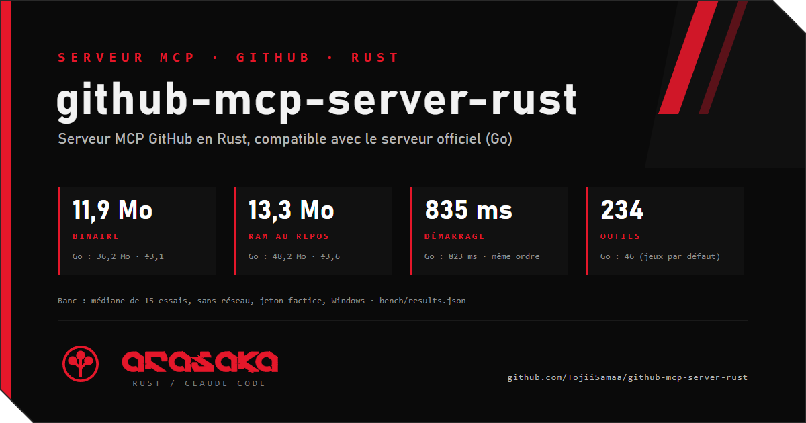

  <!-- scan:ok -->

github-mcp-server-rust (`ghmcp`) est un serveur MCP pour GitHub : un agent IA comme Claude peut lire et gérer dépôts, issues, PR, CI et organisations par l'API GitHub. C'est une réécriture en Rust compatible avec le serveur officiel en Go (mêmes schémas d'outils), qui ajoute plusieurs comptes à la fois, l'authentification par GitHub App, les webhooks, un journal d'activité et un mode test sans réseau. Mesuré contre l'officiel (médiane de 21 essais, Linux, conteneur limité à 2 coeurs) : binaire de 10,5 Mo contre 35,7 Mo, 12,6 Mo de RAM au repos contre 43,4 Mo, démarrage du même ordre (274 ms contre 313 ms, les plages se recoupent), 234 outils contre 46 avec les jeux par défaut du Go (91 avec `--toolsets all`).

https://github.com/TojiiSamaa/github-mcp-server-rust  <!-- scan:ok -->
